

TAS MOCK · HYPOTHETICAL · NOT OFFICIAL · NOT A FIRST PUBLICATION

Mock Game &amp; Season Manual FIRST® POWER UPSM

2018 game · 2026 robot construction · TAS-MOCK-V1 · 2026-11-09

Prepared for Taipei American School (Trident Robotics) mock kickoff drill. 
Official sources: 2018 Game Manual, 2026 Game Manual §8, 2027 Part 1 preview (mock Team Update). 
US Letter · student handout

FIRST®, the FIRST® logo, FIRST® Robotics Competition, Coopertition®, FIRST POWER UPSM, Gracious Professionalism®, and Sport for the Mind™ are trademarks of FIRST. © 2017–2018 FIRST. All rights reserved.

<strong>TAS mock notice.</strong> This document is not published, endorsed or distributed by FIRST. It paraphrases official manuals for classroom use only. Do not cite at any event. Redistribution outside TAS requires mentor approval.

# Contents {.unnumbered}

1 Introduction · 2 Overview · 3 ARCADE · 4 MATCH Play · 5 Safety · 6 Conduct · 7 Game Rules · 8 ROBOT Rules (2026) · 9 Inspection · 10 Tournaments · 11 Glossary · Appendix A AprilTag fiction

# 1 Introduction {.introduction}

## 1.1 About this mock kickoff {.no-counter}

On **6 January 2018**, FIRST revealed FIRST POWER UP, the FRC game for the 2018 season. The theme was a retro arcade: two alliances of video-game characters and their human operators are trapped inside an arcade game and must defeat "the boss" to escape. Each alliance has three ways to prepare for the boss fight:

1. **Control the SWITCHES and the SCALE.** Robots collect POWER CUBES and place them on PLATES. When an alliance's PLATE is tipped down far enough, the alliance has OWNERSHIP and earns points for every second it holds it.
2. **Earn POWER UPS.** Robots deliver cubes through the EXCHANGE to their HUMAN PLAYERS, who load them into the VAULT. Three POWER UPS — FORCE, BOOST and LEVITATE — give a temporary or end-of-match advantage.
3. **Climb the SCALE.** In the last thirty seconds, robots climb a RUNG on the SCALE tower to "Face the Boss", or at least park on the PLATFORM.

The game is unusual among FRC games because its main scoring is **continuous**: points accrue per second of OWNERSHIP rather than per object scored. A team that tips the SCALE early and keeps it tipped can win even if it places fewer cubes than its opponent. That single idea drives almost every strategy conversation in this manual.

For the TAS mock, imagine that this is the game we have just been handed, but that our pit is in 2026: we build with today's motors, today's control system and today's bumper rules.

## 1.2 Official game animation {.no-counter}

Watch the official animation once, as a group, before reading further. It is about three minutes long and shows every field element in motion.

VIDEO — 2018 FIRST POWER UP Game Animation (official FIRST channel)Watch: <a href="https://www.youtube.com/watch?v=HZbdwYiCY74">https://www.youtube.com/watch?v=HZbdwYiCY74</a> Embed (slides / web): <code>https://www.youtube.com/embed/HZbdwYiCY74</code> Video ID: <code>HZbdwYiCY74</code>
Published by FIRST on its official YouTube channel. Link only; the video is not reproduced here.

**While watching, each student writes down:**

- the three things a POWER CUBE can be used for;
- which field element is the same for both alliances and which elements belong to one alliance;
- what happens at the 30-seconds-left mark;
- one question about the rules that the animation does not answer.

Keep the questions. Most of them are answered in Sections 3–6, and the rest are good material for the "Q&A drill" in Appendix D.

## 1.3 How to use this manual {.no-counter}

the 2018 manual follows the structure of the real 2018 manual so that its section numbers line up with the source:

| This manual | Real 2018 manual | Content |
| --- | --- | --- |
| Section 2 | Section 2 Overview | The game in one page |
| Section 3 | Section 3 ARCADE | Field elements and dimensions |
| Section 4 | Section 4 MATCH Play | Periods, scoring, POWER UPS, penalties, drive team |
| Section 5 | Section 8 (R03–R05) and Section 7 (G05) | Robot starting size, reach and weight — the "match envelope" |
| Section 6 | Section 7 Game Rules | Curated G-rules and A-rules |

A first read should take about forty minutes. Read Sections 2 and 4.2 first (what scores), then Section 3 (where things are), then Sections 5–6 (what you may not do).

## 1.4 Coopertition {.no-counter}

Coopertition® is unqualified kindness and respect in fierce competition. Teams help and cooperate with one another even as they compete.

## 1.5 This Document and its Conventions {.no-counter}

**Which rules apply in this mock (read this first).**

| Question | Governing source |
| --- | --- |
| Game, field, scoring, penalties | **2018** manual §§3–4, 7 |
| Starting size, reach during MATCH, inspection weight | **2018** R03, R04, R05, G05 |
| Bumpers, motors, wiring, control, pneumatics, console | **2026** manual §8 |
| 2027 purchasing hints | **Mock Team Update** after §1.7 (not a rule) |
| AprilTags on field | **Appendix B (fiction) fiction** only |

2026 match-size rules **R105, R106, R107 are not used** in this student manual.

## 1.6 Translations & Other Versions {.no-counter}

This mock is English only. Official FIRST manuals are at [firstinspires.org](https://www.firstinspires.org).

## 1.7 Team Updates {.no-counter}

During a real season, FIRST posts Team Updates that change the Game Manual. **This mock includes one hypothetical update** after this section for the 2027 Part 1 preview.

<h2>MOCK Team Update TU-MOCK-2027-P1 (fiction)</h2>

<strong>Not a FIRST Team Update.</strong> Paraphrase of the 31 August 2026 blog preview for TAS purchasing discussions only.

**Table TU-1: 2027 Part 1 preview bullets**

| # | Topic | Preview summary |
| ---: | --- | --- |
| 1 | Motor cap | ≤ **18 motors** per ROBOT (new) |
| 2 | Heat/cool | No heating or cooling components for advantage (E510-like) |
| 3 | Pneumatics | No significant 2027 changes announced |
| 4 | CANivore | Allowed on 2027 Systemcore for extra CAN buses; planned removal in 2028 |
| 5 | Controllers | Original Talon and Victor SP removed from legal list |
| 6 | BAG / Mini-CIM | Off explicit list; still legal on ≤ 20 A breaker circuits |
| 7 | USB batteries | Any COTS pack ≤ 100 Wh (voltage/current condition dropped) |

Full detail and 2026 rule cross-reference: Section 8 and Table A-2 in Appendix A.

## 1.8 Question and Answer System {.no-counter}

At a real event, use the official Q&A. For this mock, mentors act as referees.

# 2 FIRST POWER UP Overview {.overview}

Each MATCH is played by two ALLIANCES (Red and Blue) of three robots each. A MATCH lasts **2 minutes 30 seconds**: a **15-second AUTO** period in which robots run only on pre-programmed instructions, then a **2 minute 15 second TELEOP** period with student drivers. The last **30 seconds** of TELEOP is the **ENDGAME**.

Just before AUTO, the Field Management System (FMS) randomly assigns which PLATE of each SWITCH and of the SCALE is red and which is blue, and sends that assignment to each team's driver station. Robot code has to read that assignment and choose an autonomous routine accordingly — a real software requirement, and a good mock exercise.

**What scores, in one table.** Values are from the 2018 manual's overview tables (Tables 2-1 and 2-2) and Table 4-1; Section 4.2 gives the full criteria.

**Table 2-1: Point values at a glance**

| Action | AUTO | TELEOP |
| --- | --- | --- |
| Cross the AUTO LINE (AUTO-RUN), per robot | 5 | — |
| SWITCH OWNERSHIP | 2 + 2 per second | 1 + 1 per second |
| SCALE OWNERSHIP | 2 + 2 per second | 1 + 1 per second |
| POWER CUBE placed in the VAULT | — | 5 |
| BOOST bonus | — | doubles the boosted OWNERSHIP points for 10 s |
| PARKING on the PLATFORM, per robot | — | 5 |
| Successful CLIMB, per robot | — | 30 |

**Ranking points (Qualification MATCHES only).** Win = 2 RP, tie = 1 RP. One extra RP for **FACE THE BOSS** (three robots CLIMBED, or two CLIMBED plus LEVITATE played). One extra RP for the **AUTO QUEST** (all three robots completed an AUTO-RUN *and* the alliance owns its SWITCH at the end of AUTO). An alliance can therefore earn up to **4 RP** per Qualification MATCH.

**The three questions every strategy must answer:**

1. *Who holds the SCALE?* The SCALE is shared and worth the same per second as your SWITCH, but you are fighting for it.
2. *How many cubes go to the VAULT, and when?* Each Vault cube is 5 points, and POWER UPS can swing OWNERSHIP points for ten seconds at a time.
3. *How many robots climb?* Three climbs is 90 points plus a ranking point. LEVITATE can stand in for one of them.

# 3 ARCADE {.arcade}

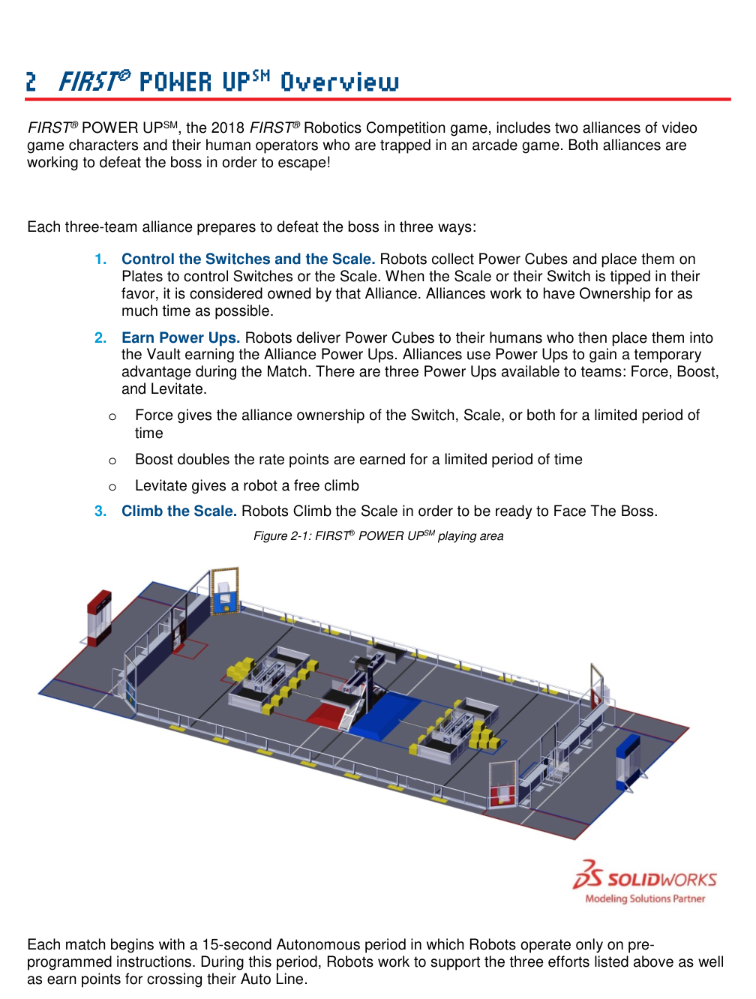

Figure 2-1 (excerpt): FIRST® POWER UP playing area — from 2018 Game Manual © FIRST. TAS mock classroom use only.

The ARCADE is everything needed to play the game: the FIELD, the SWITCHES, the SCALE, the VAULTS, the carpet, the POWER CUBES and the field electronics. The real manual stresses that its dimensions are **nominal**: fields are assembled by different crews in different venues, and good robots are designed to tolerate small variations. The official 2018 field drawings and CAD are the reference for exact values.

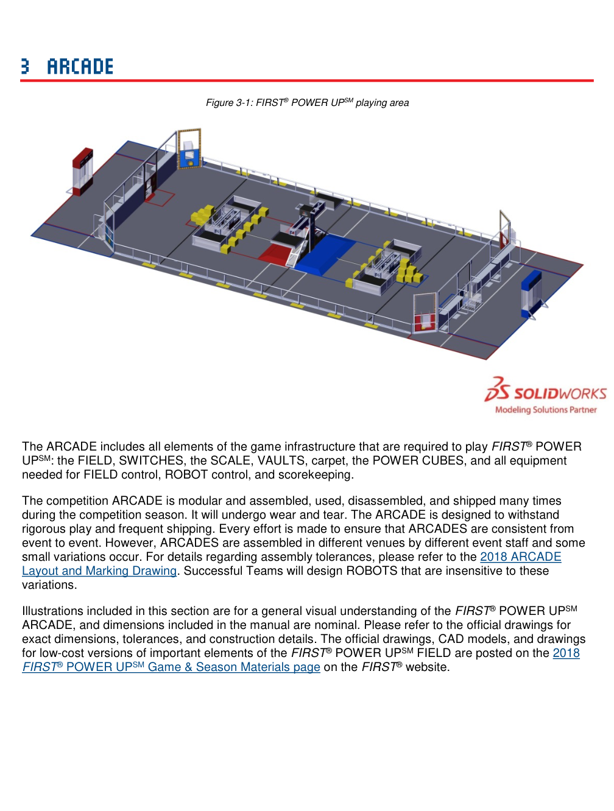

Figure 3-1 (excerpt): ARCADE playing area — 2018 Game Manual © FIRST.

## 3.1 Zones and markings {.no-counter}

Zones are volumes on the FIELD, usually bounded by 2 in. gaffer tape, and are mostly "infinitely tall": a robot is in a zone if any part of it breaks the plane of the boundary, unless a rule says "fully" or "completely".

**Table 3-1: Zones and markings (2018 §3.1, paraphrased)**

| Zone / marking | Size and location | Why it matters |
| --- | --- | --- |
| ALLIANCE STATION | 22 ft wide × 10 ft deep × 10 ft tall, behind the ALLIANCE WALL | Where drivers, coach and one or more human players stand |
| AUTO LINE | Black tape across the field, 10 ft from each ALLIANCE WALL | Crossing it with a BUMPER in AUTO = AUTO-RUN, 5 points |
| EXCHANGE ZONE | 4 ft wide × 3 ft deep in front of the EXCHANGE wall | Protected delivery area; G15 limits opponent blocking |
| NULL TERRITORY | Two areas, 7 ft 11¼ in. wide × 6 ft deep, at each end of the SCALE, against the guardrails | The alliance whose SCALE PLATE is on that side is protected there (G16) |
| PLATFORM ZONE | 11 ft 1½ in. wide × 9 ft 11¾ in. deep, between the SWITCH and the SCALE | ENDGAME protection (G18); G05 reach limit is lifted inside it during ENDGAME |
| PORTAL | 4 ft × 12 ft 11 in., at the field corners next to each alliance | Human players feed cubes onto the field |
| POWER CUBE ZONE | 3 ft 9 in. wide × 3 ft 6 in. deep, in front of each SWITCH on the alliance-wall side | Holds the alliance's cube pile; opponents may not remove cubes from it (G23) |
| STARTING LINE | White tape 2 ft 6 in. behind the ALLIANCE WALL diamond plate | Drive team positions before and during AUTO |

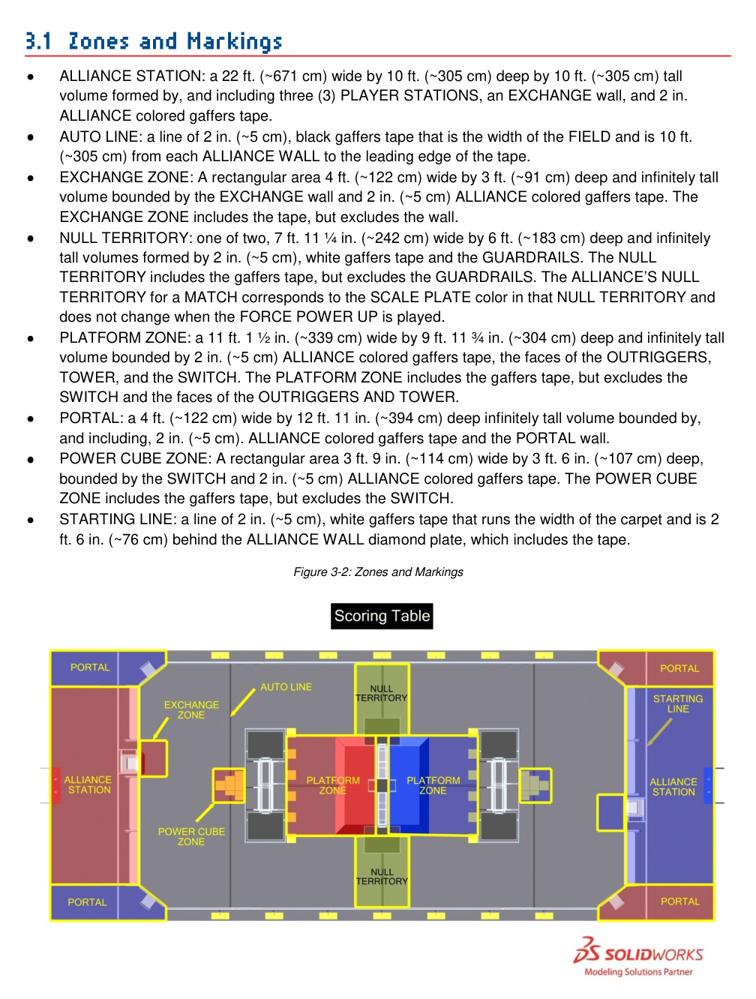

Figure 3-2 (excerpt): Zones and markings — 2018 Game Manual © FIRST.

## 3.2 FIELD {.no-counter}

The FIELD is a **27 ft × 54 ft** (about 8.2 m × 16.5 m) carpeted area bounded by the GUARDRAILS, the PORTALS, the EXCHANGE walls and the ALLIANCE WALLS. The GUARDRAIL is clear polycarbonate on aluminium extrusion. Four gates, each 3 ft 2 in. wide, let teams carry robots on and off; they are closed during a MATCH.

**Design note.** A robot that must fit through a 3 ft 2 in. gate on its cart, and through school doorways on the way to the venue, is one more reason the starting-size rule (R03, Section 5) matters.

## 3.3 SCALE {.no-counter}

There is **one SCALE**, in the centre of the field, with its arm parallel to the ALLIANCE WALLS. It consists of an arm with two PLATES, a central TOWER, OUTRIGGERS, two RUNGS and two PLATFORMS. Black cable protectors (about ⅞ in. tall once fastened) run from the centre of each PLATFORM side to the guardrails and the SWITCHES — a small bump every drivetrain must cross.

**SCALE PLATES.** Each PLATE is **3 ft wide × 4 ft deep**. The outside edges of the two PLATES are **15 ft apart**. Each PLATE has four polycarbonate walls with LED strips; the wall nearest the field centre stands **1 ft 3 in.** above the PLATE surface, the others **3½ in.**

At the start of a MATCH the PLATES are level, with their outside edges **5 ft (60 in.) ± 1 in.** above the carpet. The SCALE tips according to the weight *and position* of the cubes on each PLATE. It is always in one of three states:

**Table 3-2: SCALE states (2018 §3.3)**

| Outside edge of an alliance's PLATE, above carpet | State |
| --- | --- |
| 4 ft 0 in. to 4 ft 8 in. (48–56 in.) | That alliance has OWNERSHIP |
| 4 ft 8 in. to 5 ft 4 in. (56–64 in.) | Neither alliance has OWNERSHIP (balanced band) |
| 5 ft 4 in. to 6 ft 0 in. (64–72 in.) | The opposing alliance has OWNERSHIP |

The manual warns that equal cube counts do not guarantee balance: where cubes sit on a PLATE changes the torque. A cube placed at the outer end of a PLATE is worth more tilt than a cube near the tower.

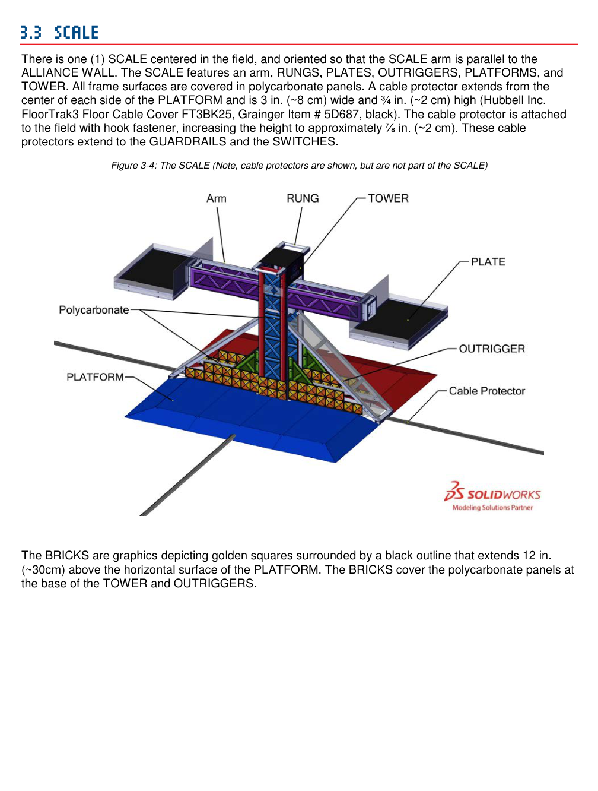

Figure 3-4 (excerpt): The SCALE — 2018 Game Manual © FIRST. See also Figure 3-6 for range of motion.

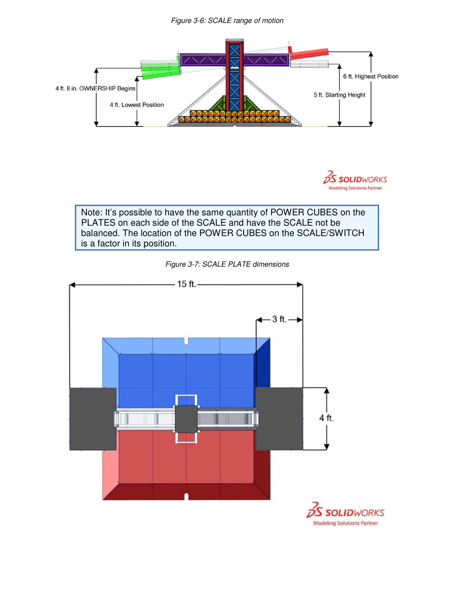

Figure 3-6 (excerpt): SCALE range of motion — 2018 Game Manual © FIRST.

**RUNGS.** At the top of the SCALE are two RUNGS, one per alliance, each reaching into that alliance's PLATFORM ZONE. A RUNG is a **1 ft 1 in. (13 in.) long, 1¼ in. Schedule 40 aluminium pipe**, extending **8¼ in.** from the vertical face of the SCALE supports. The **top of the RUNG is 7 ft (84 in.)** above the carpet.

**BRICKS.** Gold-and-black brick graphics cover the base of the TOWER and OUTRIGGERS up to **12 in. above the PLATFORM** surface. They matter for scoring: a robot only counts as CLIMBED if its BUMPERS are fully above the BRICKS at the end of the MATCH (Section 4.2).

**TOWER and OUTRIGGERS.** The TOWER is the central structure supporting the RUNGS and PLATES; it is **17 in. wide** and stands **2 in.** proud of the OUTRIGGER faces. All frame surfaces are covered in polycarbonate.

**PLATFORM.** At the base of the SCALE, on each alliance's side, is a PLATFORM covered in alliance-coloured HDPE. Its top is **8 ft 8 in. wide × 3 ft 5¼ in. deep** and **3½ in. tall**, with ramps **1 ft 1 in.** long at **15.35°**. The alliance-coloured tape that abuts the ramps counts as part of the PLATFORM.

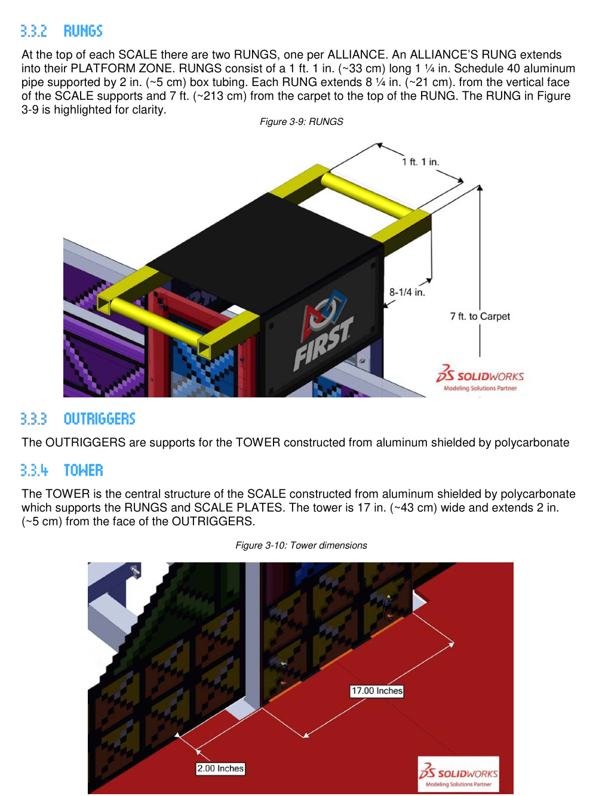

Figure 3-9 (excerpt): RUNGS — 2018 Game Manual © FIRST.

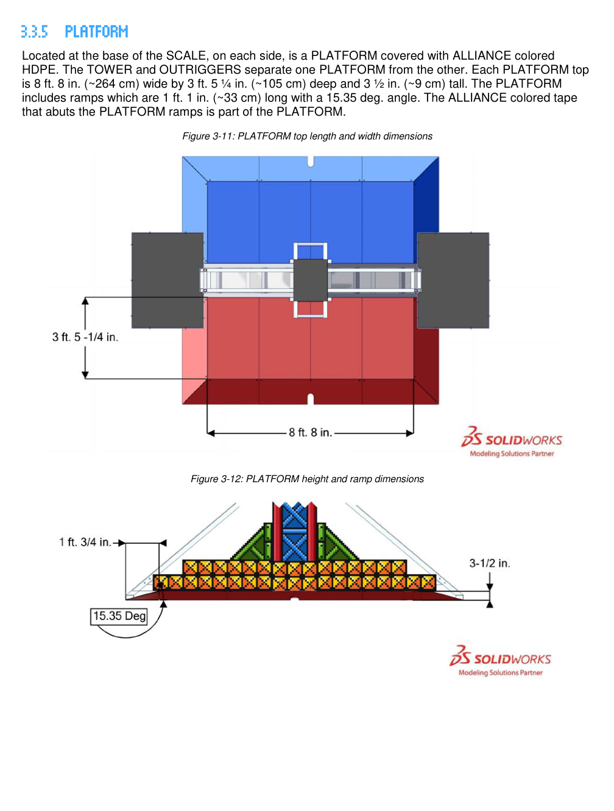

Figure 3-11–3-12 (excerpt): PLATFORM dimensions — 2018 Game Manual © FIRST.

## 3.4 SWITCH {.no-counter}

There are **two SWITCHES**, one per alliance, each centred across the field width with its centre **14 ft** from the alliance's ALLIANCE STATION. *Your* SWITCH is the one nearest your ALLIANCE STATION. Any robot may place cubes on either SWITCH, but only the owning alliance scores from it.

**SWITCH PLATES.** Each SWITCH has two PLATES, **3 ft × 4 ft**, whose outside edges are **12 ft apart**. Walls and lighting match the SCALE PLATES (1 ft 3 in. centre-facing wall, 3½ in. elsewhere). When the SWITCH is level, the PLATES sit **9 in.** above the carpet.

**Table 3-3: SWITCH states (2018 §3.4)**

| Outside edge of an alliance's PLATE, above carpet | State |
| --- | --- |
| 3 in. to 6 in. | That alliance has OWNERSHIP of its SWITCH |
| 6 in. to 15 in. | Neither alliance has OWNERSHIP |

**FENCE.** Each SWITCH is surrounded by a FENCE **12 ft 9½ in. wide × 4 ft 8 in. deep × 1 ft 6¾ in. (18.75 in.) tall**. The gap between the FENCE and the sides of the PLATES is about 1½ in.; between the FENCE and the outer ends of a level PLATE, about 2¼ in.

<blockquote class="mock-notice"><strong>Teaching trap — 9 in. vs 18.75 in.</strong> The PLATE is 9 in. off the carpet, but the FENCE around it is 18.75 in. tall. The height your mechanism actually has to clear is the <strong>fence</strong>, plus the 13 × 13 × 11 in. cube you are holding. Students who design to "9 in." build robots that can't score on the SWITCH.</blockquote>

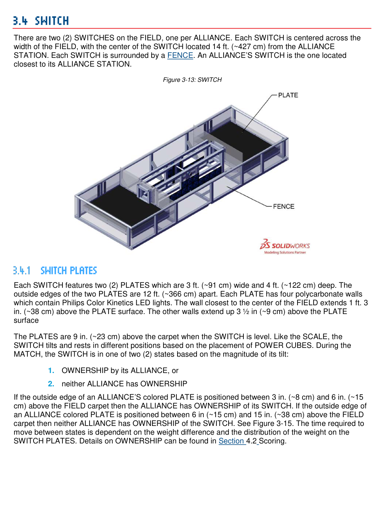

Figure 3-13 (excerpt): SWITCH — 2018 Game Manual © FIRST.

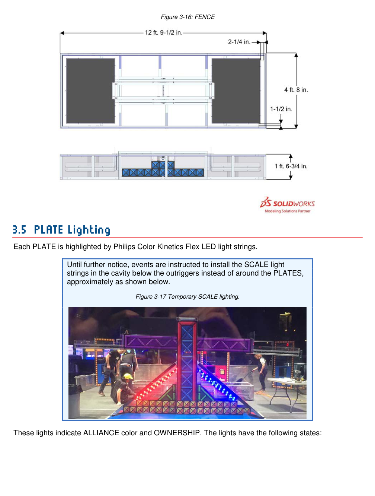

Figure 3-16 (excerpt): FENCE — 2018 Game Manual © FIRST.

## 3.5 PLATE lighting {.no-counter}

Each PLATE is outlined with LED strings that show the alliance colour of the PLATE and the state of play: pulsing when that colour owns the element, dim (about 25%) when the other colour owns it, a chase pattern while that alliance's BOOST is active, and pulsing with corners in the opposite colour while FORCE is active. After the MATCH, **purple** means "safe for field staff only" and **green** means "safe for everyone" — drive teams wait for green before stepping onto the field (S02). The 2018 manual notes that, during the season, events were told to move the SCALE light strings to the cavity under the OUTRIGGERS.

## 3.6 ALLIANCE WALL, EXCHANGE and VAULT {.no-counter}

The ALLIANCE WALL separates the robots from the drive teams. It holds three PLAYER STATIONS and one EXCHANGE.

**PLAYER STATION.** Each has a 3 ft diamond-plate base with a 3 ft 6 in. clear panel above it and a shelf **5 ft 9 in. wide × 1 ft deep** for the OPERATOR CONSOLE, with a **4 ft 6 in.** strip of hook-and-loop tape. Each station provides an Ethernet cable to the FMS, a 120 VAC outlet on its own 2 A breaker, an E-Stop button, a team sign and a team LED (solid = connected and enabled; blinking = waiting for the match, or lost connection during it).

**EXCHANGE.** A polycarbonate wall **6 ft 5¾ in. tall × 4 ft wide** between PLAYER STATIONS 1 and 2.

- **Lower opening** (robot → human): **1 ft 4¼ in. (16.25 in.) tall × 1 ft 9 in. wide**, with a small 1¾ in. ramp up to conveyor rollers that the HUMAN PLAYER spins to pull the cube through a tunnel about 2 ft deep.
- **RETURN** (human → robot): a **1 ft 2 in. (14 in.) square** opening centred above the lower opening, **1 ft 8 in. (20 in.)** above the carpet, with a chute and a swinging wall that pushes the cube onto the field.

**VAULT.** Behind the EXCHANGE, inside the ALLIANCE STATION. Three columns, each about **13½ in. wide × 39¼ in. tall**, bottom **15½ in.** off the floor. Facing the open columns from the ALLIANCE STATION: **FORCE** on the left, **LEVITATE** in the centre, **BOOST** on the right. Each column holds up to three cubes; a row of lights counts them, and a button plays the POWER UP. The manual advises placing cubes logo-side-down so three always fit and are sensed reliably.

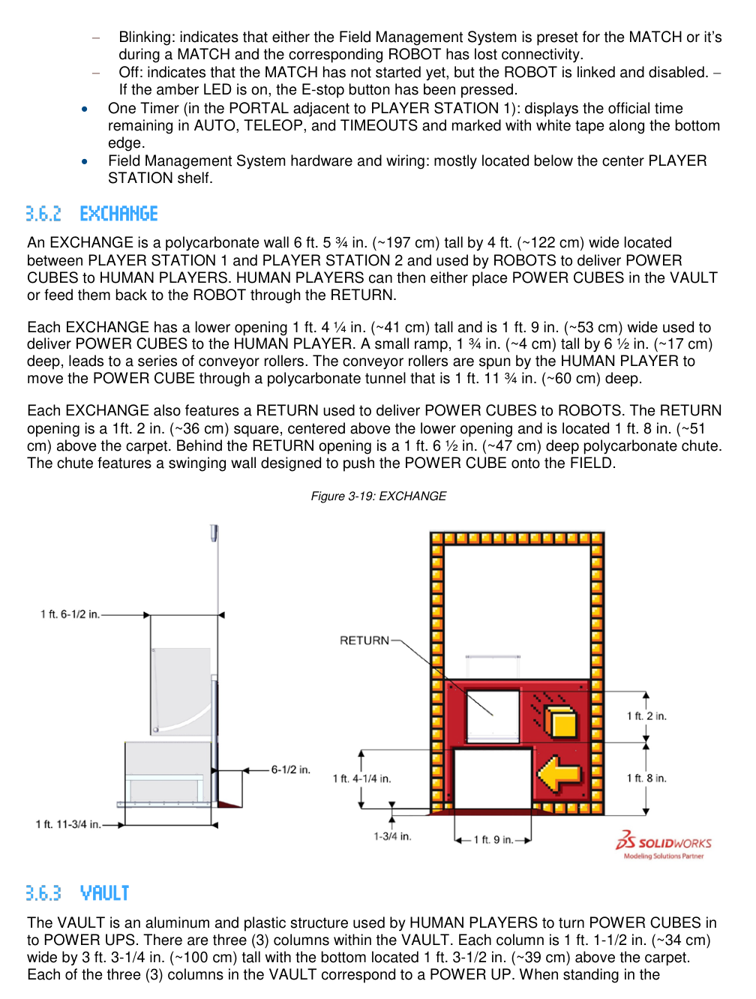

Figure 3-19 (excerpt): EXCHANGE — 2018 Game Manual © FIRST.

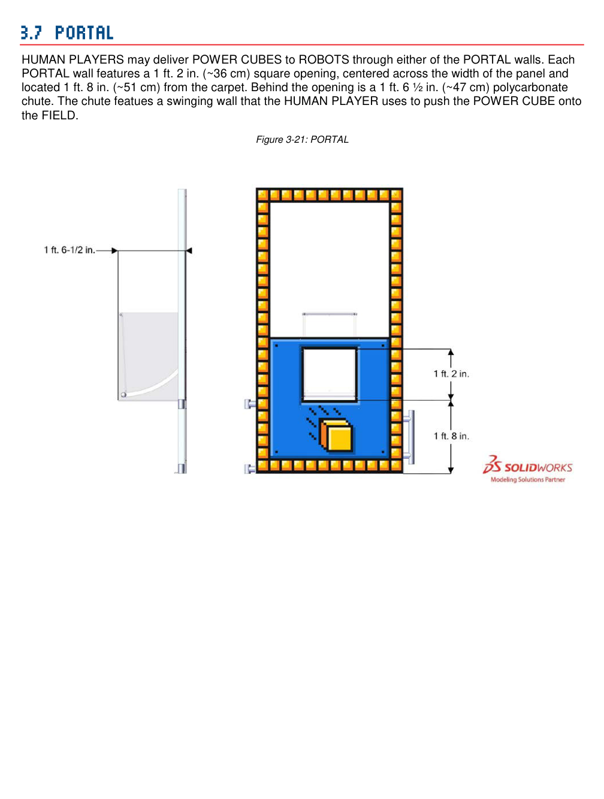

Figure 3-21 (excerpt): PORTAL — 2018 Game Manual © FIRST.

## 3.7 PORTAL {.no-counter}

Each alliance has two PORTALS, one at each corner of its end of the field. A HUMAN PLAYER standing in a PORTAL can push cubes onto the field through a **14 in. square opening, 20 in. above the carpet**, using a chute with a swinging wall — the same geometry as the EXCHANGE RETURN. A robot that can take a cube from a 20 in. chute can therefore be fed from three places.

## 3.8 POWER CUBE {.no-counter}

A POWER CUBE is a **13 in. × 13 in. × 11 in. tall** HDPE milk crate in a yellow nylon cover, with the FIRST logo over the open face. It weighs about **3¼ lb (1.5 kg)**. Cubes are soft-sided enough to squash slightly in a roller intake and stiff enough to stack.

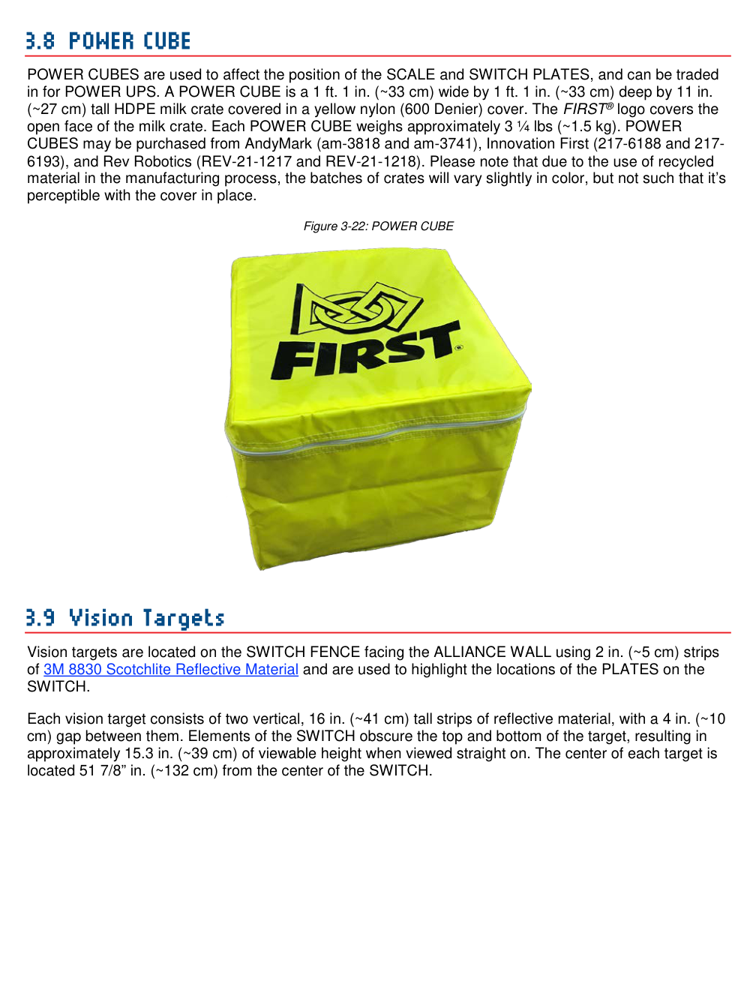

Figure 3-22 (excerpt): POWER CUBE — 2018 Game Manual © FIRST.

## 3.9 Vision targets {.no-counter}

The real 2018 field had **retro-reflective tape**, not AprilTags. Each SWITCH FENCE carried targets on its faces toward the ALLIANCE WALLS, one per PLATE: two vertical 2 in. strips, 16 in. tall, 4 in. apart, with about 15.3 in. visible when viewed straight on, centred **51⅞ in.** from the centre of the SWITCH.

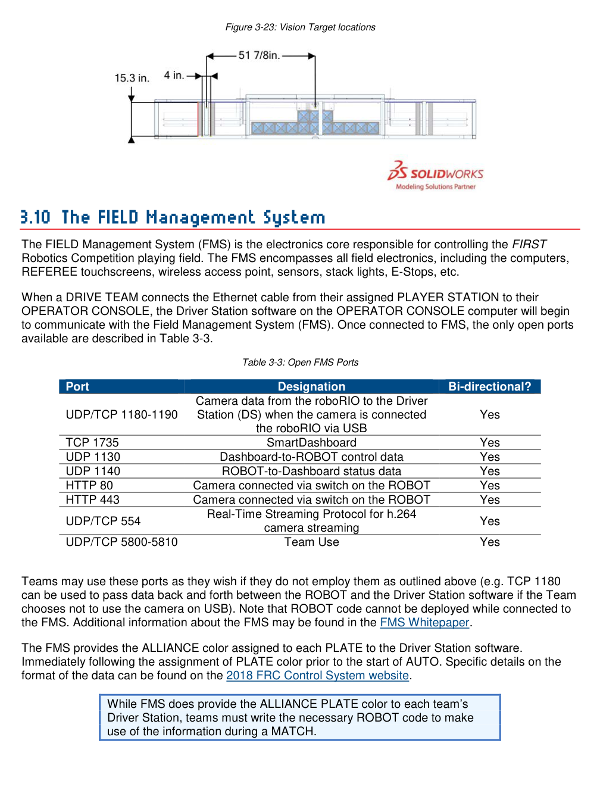

Figure 3-23 (excerpt): Vision target locations (retro-reflective tape) — 2018 Game Manual © FIRST.

<blockquote class="mock-notice fiction"><strong>FICTION reminder.</strong> AprilTags did not exist on any 2018 field. Appendix B (fiction) gives a TAS-invented 32-tag layout so vision students share a vocabulary. It is never used at a real event and is not a hint about any future game.</blockquote>

## 3.10 The FIELD Management System {.no-counter}

The FMS runs the field: computers, referee tablets, the wireless access point, sensors, stack lights and E-Stops. When a team plugs its OPERATOR CONSOLE into the PLAYER STATION Ethernet, the Driver Station software talks to the FMS, and only listed network ports are open. Robot code cannot be deployed while connected to the FMS.

The software requirement that matters most in this game: **the FMS sends each team the PLATE colour assignment just before AUTO.** The manual is explicit that teams must write the robot code to use it. A robot that ignores it is guessing which side of the SCALE is its own.

Audio cues mark the MATCH (for example, three bells at the start of TELEOP and a train whistle at 30 seconds left), but the field timers, not the sounds, are official.

# 4 MATCH Play {.matchplay}

## 4.1 Stages and setup {.no-counter}

**Stages.** AUTO is the first **0:15**: robots act only on pre-loaded code, with no drive-team input. TELEOP is the remaining **2:15**: drivers control the robots. The last **0:30** of TELEOP is the ENDGAME. Before and after each MATCH, crews reset the field and the next drive teams load in.

Figure 4-1 (placeholder): the four possible PLATE colour assignments. See 2018 manual §4.1.

**Cube staging (per alliance side, 2018 §4.1).**

- **7** cubes in each PORTAL, minus any preloads (at least **5** must remain in each PORTAL);
- **6** cubes along the SCALE-facing side of each SWITCH FENCE, evenly spaced;
- **10** cubes in each alliance's POWER CUBE ZONE pile, a 6-3-1 pyramid against the SWITCH.

Each robot may **preload one cube**, held entirely by the robot.

**Placement order.** If either alliance asks, robots are placed alternately (in Qualifications: Red 1, Blue 1, Red 2, Blue 2, Red 3, Blue 3; in Playoffs the higher seed places last).

## 4.2 Scoring {.no-counter}

The main way to score is OWNERSHIP of your SWITCH or of the SCALE.

**SWITCH OWNERSHIP.** An alliance owns its SWITCH when, for at least one second, its PLATE's outside edge is **at or below 6 in.**, *or* it has played FORCE at level 1 or 3.

**SCALE OWNERSHIP.** An alliance owns the SCALE when, for at least one second, its PLATE's outside edge is **at or below 4 ft 8 in. (56 in.)** and the opponent does not have an active level 2 or 3 FORCE, *or* it has played FORCE at level 2 or 3.

OWNERSHIP pays an entry bonus when it is established, plus points for every further second. Points already earned are never taken away; when OWNERSHIP changes, accumulation stops (if balanced) or switches to the other alliance.

**Table 4-1: FIRST POWER UP rewards (paraphrase of 2018 Table 4-1)**

<table class="scoring">
<thead><tr><th>Action</th><th>Criteria (paraphrased)</th><th>AUTO pts</th><th>TELEOP pts</th><th>RP</th></tr></thead>
<tbody>
<tr><td>AUTO-RUN</td><td>Per robot whose BUMPER breaks the plane of its AUTO LINE at any time in AUTO</td><td>5</td><td>—</td><td>—</td></tr>
<tr><td>OWNERSHIP — SCALE</td><td>Per Section 4.2 above</td><td>2 + 2/s</td><td>1 + 1/s</td><td>—</td></tr>
<tr><td>OWNERSHIP — own SWITCH</td><td>Per Section 4.2 above</td><td>2 + 2/s</td><td>1 + 1/s</td><td>—</td></tr>
<tr><td>VAULT</td><td>Per cube placed in the VAULT</td><td>—</td><td>5</td><td>—</td></tr>
<tr><td>PARKING</td><td>Per robot fully supported by the SCALE (directly or through another robot), not in the opponent's PLATFORM ZONE, and not CLIMBED</td><td>—</td><td>5</td><td>—</td></tr>
<tr><td>CLIMBING</td><td>Per robot fully supported by the SCALE, BUMPERS fully above the BRICKS at T=0, not touching its PLATFORM, not in the opponent's PLATFORM ZONE</td><td>—</td><td>30</td><td>—</td></tr>
<tr><td>FACE THE BOSS</td><td>Three robots CLIMBED, or two CLIMBED and LEVITATE played</td><td>—</td><td>—</td><td>1</td></tr>
<tr><td>AUTO QUEST</td><td>Three AUTO-RUNS and OWNERSHIP of own SWITCH at the end of AUTO</td><td>—</td><td>—</td><td>1</td></tr>
<tr><td>Win / Tie</td><td>Final score higher / equal</td><td>—</td><td>—</td><td>2 / 1</td></tr>
</tbody></table>

**Worked example (from the manual's own example).** An alliance takes its SWITCH 3 seconds into AUTO and holds it for 5 seconds: 2 points for establishing OWNERSHIP + 5 × 2 = 10 points for the seconds held = **12 points**.

**Note — PARKING.** "Fully supported by the SCALE" includes standing on the PLATFORM, since the PLATFORM is part of the SCALE.

**Note — referees.** AUTO-RUN and CLIMBING are judged by human referees, not sensors. The manual tells teams to make both obvious. A climb that ends with a bumper an inch from the BRICK line invites a "no".

**Cubes delivered through the EXCHANGE.** The HUMAN PLAYER may (1) put the cube in the VAULT for 5 points and progress toward a POWER UP, (2) send it back through the RETURN, or (3) keep it in the ALLIANCE STATION for later.

## 4.3 POWER UPS {.no-counter}

POWER UPS are earned by filling VAULT columns and played by pressing that column's button during TELEOP.

**Table 4-2: POWER UPS (paraphrase of 2018 Table 4-2)**

| Name | Cubes in column | Effect | Duration |
| --- | :---: | --- | :---: |
| LEVITATE | 3 | One extra CLIMBING robot is credited to the alliance at the end of the MATCH (maximum three CLIMBS total) | N/A |
| FORCE | 1 | Alliance earns OWNERSHIP points for its SWITCH regardless of PLATE position | 10 s |
| FORCE | 2 | … for the SCALE | 10 s |
| FORCE | 3 | … for both its SWITCH and the SCALE | 10 s |
| BOOST | 1 | Doubles the OWNERSHIP points the alliance is earning from its SWITCH | 10 s |
| BOOST | 2 | … from the SCALE | 10 s |
| BOOST | 3 | … from both its SWITCH and the SCALE | 10 s |

**Rules of play for POWER UPS (2018 §4.3, paraphrased):**

- **Only one FORCE or BOOST can be active on the field at a time.** If one is running and the *other* alliance plays FORCE or BOOST, theirs is **queued** and starts the moment the current one ends. If an alliance presses FORCE or BOOST while its own other FORCE/BOOST is active, the press is ignored.
- Each POWER UP can be played **once per MATCH**. Once played it cannot be cancelled. FORCE and BOOST can be played with 1, 2 or 3 cubes in their column; the level is the number of cubes at the moment of the press.
- Cubes added to a column *after* its POWER UP has been played still score 5 VAULT points.
- **LEVITATE** can be played at any time in TELEOP and is not queued. At the end of the MATCH the climb is credited to a robot that is neither PARKING nor CLIMBING; if every robot is PARKING or CLIMBING, a PARKING robot is upgraded to CLIMBING.

Figure 4-3 (placeholder): POWER UP timeline example — Red FORCE at 0:60 runs to 0:50; Blue BOOST pressed at 0:55 is queued until 0:50; Red BOOST pressed at 0:48 is queued until Blue's ends at 0:40; Blue LEVITATE at 0:35 is immediate. See 2018 manual §4.3.

<blockquote class="mock-notice"><strong>Strategy note.</strong> The queue makes timing a weapon: playing a POWER UP early in a period when your opponent wants to play theirs pushes theirs later. Because LEVITATE costs three cubes and only ever replaces <em>one</em> climb, it is most valuable to an alliance with two reliable climbers — it turns them into FACE THE BOSS.</blockquote>

## 4.4 Rule violations {.no-counter}

**Table 4-3: Penalties (2018 Table 4-3, paraphrased)**

| Penalty | Effect |
| --- | --- |
| FOUL | 5 points added to the opponent's score |
| TECH FOUL | 25 points added to the opponent's score |
| YELLOW CARD | A warning from the Head Referee for egregious behaviour or violations; a second YELLOW in the same tournament phase becomes a RED |
| RED CARD | The team is DISQUALIFIED for that MATCH |
| DISABLED | The robot is commanded to turn off all outputs for the rest of the MATCH |
| DISQUALIFIED | Zero MATCH points for the team in Qualifications; zero for the whole alliance in Playoffs |

## 4.5 DRIVE TEAM {.no-counter}

A DRIVE TEAM is up to **five** people from one team.

**Table 4-4: DRIVE TEAM roles (2018 Table 4-4, paraphrased)**

| Role | What they do | Max | Who |
| --- | --- | :---: | --- |
| COACH | Guide / advisor | 1 | Student or adult mentor |
| DRIVER and HUMAN PLAYER | Operate the robot; manage POWER CUBES at the EXCHANGE, VAULT and PORTALS | 3 combined | Pre-college students |
| TECHNICIAN | Robot set-up, connectivity, console troubleshooting, removal from the field | 1 | Pre-college student |

The TECHNICIAN was new in 2018. They stand outside the ALLIANCE STATION (usually with the robot cart) and should know the radio, roboRIO lights, console login, battery change and pneumatic charging. The manual also expects every drive-team member to know where the main breaker is and how to release the robot from the SCALE after a climb.

## 4.6 Logistics {.no-counter}

- A cube that leaves the FIELD is out of play for the rest of the MATCH (one that bounces straight back in is fair game). Robots may not deliberately send cubes out of the field except through the EXCHANGE lower opening (G21).
- A MATCH is not replayed because cubes were missing, misplaced or damaged at the start; tell field staff *before* the MATCH.
- After the MATCH, wait for **green** PLATE lights before entering the field.

# 5 Safety Rules {.safety}

Selected 2018 safety rules apply at all events. Read **S01–S06** in the official 2018 manual for fire, eye protection, battery, main breaker, compressed gas and sharp-edge requirements. Mock summary: wear safety glasses in the pit and on the field; one main breaker accessible to the drive team; no modifications that defeat safety interlocks.

# 6 Conduct Rules {.conduct}

**C01–C10** govern drive-team behaviour (Gracious Professionalism, field access, wireless restrictions in the venue). Violations range from warnings to RED CARD. For this kickoff, focus on **C07**: do not attempt to draw G18 violations by baiting opponents in the PLATFORM ZONE.

# 7 Game Rules {.gamerules}

This section collects the 2018 game rules most likely to change a design or a strategy. It is **not** the full rule set: the 2018 manual also has safety rules (S01–S06), conduct rules (C), human rules (H01–H09) and further A-rules. Each box gives the rule's own short title in quotes, a paraphrase and the violation. Citations are to [2018 Game Manual §7](https://firstfrc.blob.core.windows.net/frc2018/Manual/2018FRCGameSeasonManual.pdf).

## 7.1 Before the MATCH {.no-counter}

G01 — "Know your ROBOT setup."When placed on the field, each robot must: have passed inspection; be the only item the drive team leaves on the field; be in its STARTING CONFIGURATION; sit on the carpet; touch its ALLIANCE WALL diamond plate; not touch the EXCHANGE wall or break the plane of the EXCHANGE ZONE; and hold no more than one POWER CUBE.
<strong>Violation:</strong> the MATCH waits for a quick fix; otherwise the robot is DISABLED and may need re-inspection.

2018 §7.1

G03 — "Know your DRIVE TEAM positions."Before the MATCH, drivers and coach stand in their ALLIANCE STATION behind the STARTING LINE; HUMAN PLAYERS stand behind the STARTING LINE in the ALLIANCE STATION or a PORTAL; the TECHNICIAN stands in the designated area outside both.
<strong>Violation:</strong> the MATCH does not start until corrected.

2018 §7.1

G04 — "Leave the POWER CUBES alone."Before the MATCH, drive teams may not rearrange cubes in a PORTAL or on the field (other than one preloaded in their robot), or move cubes from one PORTAL to another.
<strong>Violation:</strong> the MATCH does not start until corrected.

2018 §7.1

## 7.2 ROBOT Restrictions {.no-counter}

G05 — "Don't overextend yourself."No more than <strong>16 in.</strong> beyond the FRAME PERIMETER, except a robot fully within its own PLATFORM ZONE during the ENDGAME. See R04 and G05 in Section 8.2.
<strong>Violation:</strong> FOUL; RED CARD if strategic.

2018 §7.2

G06 — "Keep it together."Robots may not <em>intentionally</em> detach parts or leave them on the field. Accidental breakage is not penalised under this rule.
<strong>Violation:</strong> RED CARD.

2018 §7.2

G07 — "Keep your BUMPERS together."Robots must meet the bumper rules for the whole MATCH.
<strong>Violation:</strong> FOUL. DISABLED if a bumper segment comes completely off, a whole side of the robot is exposed, or the team number or alliance colour can no longer be determined.

2018 §7.2. In this mock, bumpers are <em>built</em> to 2026 rules (Sec 8.4), and G07 is how the game enforces them on the field.

G08 — Robots are removed by hand.After the MATCH, robots are carried off unpowered. They are not re-enabled, and teams may not tether to them (wired or wireless) on the field except in special circumstances with the FTA's or a referee's permission.
<strong>Violation:</strong> YELLOW CARD.

2018 §7.2. Design consequence: a climber must be releasable by hand, unpowered, without dropping the robot.

G09 — "Launching POWER CUBES is okay, but keep it short."A robot may launch a cube only when (A) its bumpers are in its own NULL TERRITORY and it is placing on the SCALE PLATE in that territory; (B) its bumpers touch a SWITCH FENCE, or part of it is inside the vertical planes of the FENCE, and it is placing on the nearest PLATE of that SWITCH; or (C) its bumpers are in its own EXCHANGE ZONE and it is placing into its EXCHANGE.
<strong>Violation:</strong> TECH FOUL per cube; repeated violations escalate quickly to cards.

2018 §7.2, Figure 7-2

## 7.3 ROBOT to ROBOT Interaction {.no-counter}

G10 — "Don't tear others down to lift yourself up."No strategies aimed at destroying or disabling other robots through attachment, damage, tipping or entanglement (a wedge to tip robots is the manual's example).
<strong>Violation:</strong> FOUL and YELLOW CARD; RED CARD if harm or incapacitation results.

2018 §7.3

G11 — "Stay out of other ROBOTS."No deliberate or damaging contact with an opponent on or inside the vertical extension of its FRAME PERIMETER, including through a POWER CUBE. High-speed accidental collisions happen; robots extend mechanisms outside their frame at their own risk.
<strong>Violation:</strong> FOUL and YELLOW CARD.

2018 §7.3

G12 — No collusion to shut down major parts of the game.Two or more robots may not close off a major part of play — blocking the EXCHANGE, blocking both PORTALS, cutting off all cubes, or boxing opponents into a small area. One robot blocking one area is not a violation; two robots each defending one opponent is not a violation.
<strong>Violation:</strong> YELLOW CARD for the alliance.

2018 §7.3

G13 — "If an opponent's down, back off."A tipped robot trying to right itself (alone or with a partner's help) gets one grace period of <strong>10 seconds</strong>, or until it is upright, during which opponents may not touch it.
<strong>Violation:</strong> FOUL; YELLOW CARD if intentional.

2018 §7.3

G14 — "There's a 5-count on pins."No pinning an opponent for more than <strong>5 seconds</strong>. A pin lasts until the robots are at least <strong>6 ft</strong> apart; the pinning robot must then wait at least <strong>3 seconds</strong> before pinning the same robot again. Pinning can be transitive through other objects, and contact is not required (trapping a robot against a wall counts). If the pinned robot chases the retreating robot, the pin is over and not penalised.
<strong>Violation:</strong> FOUL, plus another FOUL every 5 seconds until corrected; RED CARD if extended (generally more than 15 seconds).

2018 §7.3

G15 — "Opponent's EXCHANGE ZONE: no camping."A robot may not block the opponent's EXCHANGE ZONE (any part breaking its plane) for more than <strong>5 seconds</strong>; the block lasts until the robot has moved at least <strong>6 ft</strong> away. A pinned robot is exempt until the pin ends.
<strong>Violation:</strong> FOUL, plus another every 5 seconds; YELLOW CARD if extended and egregious (generally more than 15 seconds).

2018 §7.3

G16 — "The NULL TERRITORY is safe."A robot whose bumpers are in its own NULL TERRITORY (and not in the opponent's PLATFORM ZONE) may not be contacted by an opponent, directly or through a cube, <strong>no matter who starts the contact</strong>. A robot shoved into the opponent's NULL TERRITORY and wedged under the SCALE is not a violation.
<strong>Violation:</strong> TECH FOUL.

2018 §7.3

G17 — "Don't climb on each other until the end."Except during the ENDGAME, or while righting a tipped partner, robots may not strategically support a partner's weight.
<strong>Violation:</strong> TECH FOUL.

2018 §7.3

G18 — "Don't mess with opponents in their PLATFORM ZONE."During the ENDGAME, robots may not contact an opponent that is completely inside that opponent's own PLATFORM ZONE, directly or through a cube, regardless of who starts it.
<strong>Violation:</strong> the contacted robot, and every partner it is fully supporting, is counted as CLIMBED at the end of the MATCH.

2018 §7.3. The manual also points teams to conduct rule C07 about trying to draw this violation.

<blockquote class="mock-notice"><strong>Contact summary for drivers.</strong> Three places are safe for your robot: your NULL TERRITORY (G16, any time), your PLATFORM ZONE (G18, ENDGAME only), and — for five seconds — your EXCHANGE ZONE against a camper (G15). Two clocks run in your head: the 5-second pin count (G14) and the 5-second EXCHANGE count (G15).</blockquote>

## 7.4 FIELD Interaction {.no-counter}

G19 — "Be careful about what you interact with."Drive teams, robots and consoles may not grab, grasp, attach to, hang from, deform, become entangled with, or damage field elements. Grabbing, grasping, attaching and hanging are allowed on <strong>RUNGS and POWER CUBES</strong> (that is how robots climb and carry cubes). Normal cube wear is expected; gouging or tearing cubes is not.
<strong>Violation:</strong> FOUL during a MATCH; YELLOW CARD if extended or repeated; DISABLED if further damage is likely.

2018 §7.4

G20 — "POWER CUBES: use as directed."Apart from placing them on PLATES, robots may not use cubes to make field elements easier or harder — for example, stacking cubes under a PLATE, climbing on cubes, using cubes to block opponents, or (egregiously) placing a cube on top of the SCALE to block the opponent's RUNG.
<strong>Violation:</strong> TECH FOUL per cube; escalates quickly to cards.

2018 §7.4

G21 — "Keep POWER CUBES in bounds."Except through the EXCHANGE lower opening, robots may not intentionally eject cubes from the field.
<strong>Violation:</strong> FOUL per cube.

2018 §7.4

G22 — "One POWER CUBE per ROBOT."A robot may control at most <strong>one</strong> cube. "Control" includes carrying, herding (deliberately pushing a cube somewhere), trapping it against a field element, and launching. Not control: bulldozing (incidental contact while driving), deflecting, briefly plowing through a pile, and nudging a cube already on a PLATE while placing another. A cube lodged in or on a robot counts as controlled.
<strong>Violation:</strong> FOUL per extra cube; escalates to cards.

2018 §7.4. Design consequence: an intake must be physically unable to swallow a second cube.

G23 — Opponent's POWER CUBE ZONE is off limits.Robots may not remove cubes from, or cause cubes to be removed from, the opponent's POWER CUBE ZONE — including by pushing one cube with another.
<strong>Violation:</strong> FOUL per cube.

2018 §7.4

G24 — "POWER CUBES stay on PLATES."No strategies aimed at removing cubes from PLATES (sweeping them off with an arm, launching at a stack to knock it over).
<strong>Violation:</strong> TECH FOUL per cube removed.

2018 §7.4

G25 — "PLATES are moved by POWER CUBES, not ROBOTS."Apart from the weight of placed cubes, robots may not cause or prevent PLATE movement, directly or through a cube. Momentary contact with minimal movement (the blue box says roughly under 1 second and under 3 in.) is not a violation; neither is a robot shoved under the SCALE by an opponent.
<strong>Violation:</strong> FOUL per instance, plus a TECH FOUL for every 5 seconds not corrected; escalates to cards.

2018 §7.4. Examples in the manual: holding the SCALE level; holding a PLATE up.

## 7.5 AUTO Period Rules {.no-counter}

A01–A03 — Hands off during AUTO.During AUTO, drive-team members may not touch anything in front of the STARTING LINE (A01), may not interact with their robot or console except for safety or an E-Stop (A02 — adjusting the console after PLATE colours are assigned is a violation), and must disconnect any controllers they are holding or wearing (A03).
<strong>Violation:</strong> A01 FOUL per item; A02 FOUL and YELLOW CARD; A03 FOUL.

2018 §7.5

A04 — "Stay out of your opponent's side of the FIELD."During AUTO, no part of a robot's bumpers may cross from the NULL TERRITORY into the opponent's side of the field.
<strong>Violation:</strong> FOUL; TECH FOUL if contact is made with an opponent on its side; escalates to cards.

2018 §7.5

<blockquote class="mock-notice"><strong>Design consequences of the 2018 manual, in one list.</strong> (1) Clear an 18.75 in. FENCE with a cube. (2) Reach 48–72 in. SCALE PLATE edges without exceeding 16 in. horizontally. (3) Fit a cube through a 16.25 in. EXCHANGE opening and take cubes from 20 in. chutes. (4) Hold exactly one cube. (5) Climb an 84 in. RUNG, finishing with bumpers above the 12 in. BRICKS, and be removable unpowered. (6) Start inside 33 × 28 × 55 in. (7) Read the FMS PLATE colours in AUTO.</blockquote>

# 8 ROBOT Rules {.robotrules}

This section of the mock manual presents **2026 ROBOT construction rules** (REBUILT §8) for hardware TAS would build today. **2018 R03, R04 and R05** at the start of this section set the match envelope; **2026 match-size rules R105–R107 are not used.**

Citation: [2026 Game Manual TU22](https://firstfrc.blob.core.windows.net/frc2026/Manual/2026GameManual.pdf), Section 8.

In this mock, the robot's **match envelope** — how big it may be at the start, how far it may reach during play, and how much it may weigh at inspection — comes from the **2018** manual, because these rules were written for this field. Four rules do the work: R03, R04 and R05 from 2018 Section 8, and G05 from 2018 Section 7, which restates R04 as a game rule with a penalty.

**Mock precedence.** Match envelope from 2018. Citation: [2018 FRC Game and Season Manual](https://firstfrc.blob.core.windows.net/frc2018/Manual/2018FRCGameSeasonManual.pdf), §8.2 (R01–R05) and §7.2 (G05).

## 8.2 General ROBOT Design — FRAME PERIMETER (2018 R01) — the reference for everything {.no-counter}

Both size rules are measured from the **FRAME PERIMETER**. In 2018 (R01) it is found by wrapping a string around the robot, *excluding bumpers*, at bumper height and pulling it taut; the string outlines the FRAME PERIMETER. It must be made of fixed, non-articulated structure. Bolt heads, rivets and similar protrusions up to ¼ in. are ignored.

**Mock note.** The 2026 manual calls the same idea the ROBOT PERIMETER (2026 R101) and finds it with the same taut-string method. For this mock, treat the 2026 ROBOT PERIMETER of a TAS robot as its 2018 FRAME PERIMETER. Everything in this section is then measured from that string line.

### R03 — Starting configuration size {.no-counter}

R03 — Starting configuration size (2018)In its STARTING CONFIGURATION, the robot <strong>excluding BUMPERS</strong> must fit inside a box <strong>33 in. × 28 in. × 55 in. tall</strong> (about 83 × 71 × 139 cm). Minor protrusions of less than ¼ in. are exempt from the 33 in. and 28 in. limits.
<strong>Enforced at:</strong> inspection. Teams should expect to demonstrate that the robot can constrain itself to this box; the constraint may be hardware or software.

Source: 2018 Game Manual §8.2, R03. See also R02 (nothing outside the vertical projection of the FRAME PERIMETER at the start, except bumpers and minor protrusions).

**What it means for POWER UP.** A **55 in.** starting height lets an elevator robot start with its first stage already tall, so it can reach the SCALE quickly in AUTO. The 33 × 28 in. footprint is a box, not a perimeter limit: a long, thin chassis that might be legal under a perimeter-length rule can fail R03. Common 26–27½ in. square swerve frames fit comfortably.

**Read R02 with R03.** At the start, nothing may stick out past the vertical projection of the FRAME PERIMETER. Intakes, arms and climbers must therefore start folded *inside* the frame outline, as well as inside the 55 in. height.

### R04 and G05 — Extension limit (see also Section 7.2) {.no-counter}

R04 — Extension limit (2018)Robots may not extend more than <strong>16 in. (~40 cm) beyond their FRAME PERIMETER</strong>, except during the ENDGAME (see G05).
Source: 2018 Game Manual §8.2, R04, Figure 8-1.

G05 — "Don't overextend yourself." (2018)Robots may not extend more than <strong>16 in. (41 cm) beyond their FRAME PERIMETER</strong>. The limit does <strong>not</strong> apply to a robot that is <strong>fully within its own PLATFORM ZONE during the ENDGAME</strong>.
<strong>Violation:</strong> FOUL. If strategic (for example, the over-extension results in scoring a POWER CUBE), RED CARD.

Source: 2018 Game Manual §7.2, G05, Figure 7-1. Blue box: teams should also think about venue height, camera poles and lighting trusses.

**How to read R04 and G05 together.** R04 is the construction rule and mentions the ENDGAME; G05 is the game rule referees enforce, and it is more specific: the exemption needs the robot to be **fully inside its own PLATFORM ZONE** *and* the MATCH to be in the ENDGAME. A robot that unfolds a climber in the last 30 seconds while still half outside the PLATFORM ZONE is not exempt.

**The 16 in. is horizontal.** In 2018 the extension limit is measured outward from the FRAME PERIMETER, as Figure 7-1 of the 2018 manual shows with bars drawn in the same orientation as the frame. **The 2018 rules have no general cap on robot height during a MATCH.** That is how 2018 elevators reached the SCALE. The real limits on height were physical: venue ceilings, the 84 in. RUNG, and the robot's own centre of gravity.

**What it means for POWER UP.**

- **SWITCH:** the PLATE ends sit about 2¼ in. inside the FENCE. 16 in. of reach is plenty to put a cube over the FENCE and onto the PLATE.
- **SCALE:** scoring is a *height* problem (PLATE edges 48–72 in.), not a reach problem. An elevator or a pivoting arm that stays within 16 in. horizontally is legal at any height.
- **Floor intake:** a 13 in. cube can be grabbed by an intake that reaches less than 16 in. out.
- **Climbing:** a deployable hook or buddy-climb platform may exceed 16 in. once the robot is fully in its PLATFORM ZONE in the ENDGAME.

Figure 5-1 (placeholder, after 2018 Figures 7-1 and 8-1): extension measured from the FRAME PERIMETER — robot A over the limit, robots B and C within it.

### R05 — Weight limit (2018 inspection) {.no-counter}

R05 — Weight limit (2018)The robot may weigh no more than <strong>120 lb</strong>. All mechanisms that might be used in different configurations are weighed together. <strong>Excluded</strong> from the weight: (A) the robot's BUMPERS, and (B) the robot battery with its half of the Anderson connector pair (including no more than 12 in. of cable per leg, lugs, bolts and insulation).
<strong>Enforced at:</strong> inspection (2018 I03).

Source: 2018 Game Manual §8.2, R05.

**Mock rule of thumb.** R05 (120 lb) is the mock inspection limit. Design to the 2026 limit in R103 (**115 lb**, Section 8.2 (R103)) and you pass both. A full 2018-style robot with an elevator, intake and climber is buildable inside 115 lb.

 {.no-counter}

**Table 5-1: The 2018 match envelope used in this mock**

| Topic | Rule | Limit | Exceptions / notes |
| --- | --- | --- | --- |
| Starting size | R03 (with R02) | 33 × 28 × 55 in. tall, bumpers excluded | Protrusions < ¼ in. exempt from 33/28 in. |
| Reach during MATCH | R04, G05 | ≤ 16 in. beyond the FRAME PERIMETER | Lifted when fully inside own PLATFORM ZONE during ENDGAME |
| Height during MATCH | — | No general 2018 rule | Bounded in practice by venue, RUNG at 84 in., stability |
| Inspection weight | R05 | ≤ 120 lb, bumpers and battery excluded | Design target 115 lb (2026 R103) |

# 5 Safety Rules {.safety}

Selected 2018 safety rules apply at all events. Read **S01–S06** in the official 2018 manual for fire, eye protection, battery, main breaker, compressed gas and sharp-edge requirements. Mock summary: wear safety glasses in the pit and on the field; one main breaker accessible to the drive team; no modifications that defeat safety interlocks.

# 6 Conduct Rules {.conduct}

**C01–C10** govern drive-team behaviour (Gracious Professionalism, field access, wireless restrictions in the venue). Violations range from warnings to RED CARD. For this kickoff, focus on **C07**: do not attempt to draw G18 violations by baiting opponents in the PLATFORM ZONE.

An asterisk (*) before a rule title in the 2026 manual marks rules that apply at all times at an event, not only on the field. All rules in this section carry that mark in the source.

## 8.1 Weight — R103 {.no-counter}

R103 — "ROBOT weight limit." (2026)The robot may weigh no more than <strong>115.0 lb (52.16 kg)</strong>. Everything that might be used in a single configuration is weighed together. <strong>Excluded:</strong> (A) BUMPERS; (B) the robot battery with its half of the Anderson connector pair, including wire, lugs, bolts and insulation; (C) location-detection tags if the event provides them.
Source: 2026 Game Manual §8.1, R103. Related: R408 caps robot plus bumpers at 135.0 lb.

**In this mock:** inspection uses 2018 R05 (120 lb, Section 5.4); R103's 115 lb is the TAS **design target**. Track weight in a spreadsheet from the first CAD sketch: a 2018-style elevator robot typically spends its budget on drivetrain, elevator stages and the climber, in that order.

## 8.4 BUMPERS (summary of R401–R412) {.no-counter}

Bumpers protect robots from each other and from the field. The 2026 manual measures bumper dimensions at inspection with a **0.25 in. tolerance** (maximums +0.25 in., minimums −0.25 in.) and asks teams to design to nominal values.

**Table 8-A: 2026 bumper rules at a glance (paraphrased)**

| Rule | Title (2026) | Requirement, paraphrased |
| --- | --- | --- |
| R401 | BUMPERS almost all around | Bumpers protect the whole ROBOT PERIMETER. Gaps under 1.25 in. are allowed if corners are filled; one larger gap is allowed if at least 5.0 in. of perimeter each side of every corner is covered. Arcs count as "infinite corners". |
| R402 | BUMPER construction | Every vertical cross-section has: **padding** ≥ 2.25 in. deep and ≥ 4.5 in. tall (pool noodles/backer rod, or polyethylene, EVA or floor-tile foam within stated densities); **backing** ≥ 4.5 in. tall supporting the padding; a cloth **cover**; and a rigid **fastening system**. |
| R403 | Extension limit | Bumpers extend no more than **4.0 in.** from the ROBOT PERIMETER. |
| R404 | Must be soft | Hard parts no more than 1.25 in. out from the perimeter; padding extends at least 2.0 in. past any hard part. |
| R405 | BUMPERS interact with BUMPERS | While driving normally, padding and backing fill the **BUMPER ZONE: 2.5 in. to 5.75 in. above the floor** (relative to whatever surface the robot is on). |
| R406 | Fill corners | Corners filled with uncompressed padding at least 2.25 in. from the corner; two mitred segments do not count as filled. |
| R407 | Not wedges | No profiles that act as wedges (soft-on-top foam, semicircles, tapered padding). |
| R408 | Weight with bumpers | Robot (as weighed for R103) plus bumpers ≤ **135.0 lb**. |
| R409 | Passive | Bumpers are fixed to the perimeter, with no moving or electrical parts. |
| R410 | Must come off | Designed for removal for inspection and weighing (guideline: two people, under five minutes). |
| R411 | Show your alliance | Red or blue covers as scheduled; only listed markings allowed (team numbers, fasteners, white FIRST logos 4.75–5.25 in. wide, exposed seams). |
| R412 | Team numbers | White numerals ≥ 3.75 in. tall, ≥ 0.5 in. stroke, in at least 3 locations about 90° apart, readable from about 60 ft; not wrapped round sharp corners or split ambiguously. |

**Fit with the 2018 game.** 2018 R03 *excludes* bumpers from the 33 × 28 in. starting box, so the bumpers' up-to-4 in. thickness does not count against the footprint. The 2.5–5.75 in. bumper zone keeps a 2026 bumper low enough to cross the ⅞ in. cable protectors and climb the 3½ in. PLATFORM ramp — but check ground clearance at the ramp transition on your drivetrain.

**G07 on the field.** Built to 2026, enforced in-game by 2018 G07 (Section 6.2): a detached segment or an exposed side gets the robot DISABLED.

## 8.5 Motors and actuators — R501, R502, R503 {.no-counter}

R501 — "Allowable motors." (2026)Only the motors and actuators on the list in 2026 Table 8-1 are allowed, <strong>in any quantity</strong> (subject to R502). The list includes the CIM family, AndyMark and Banebots brushed motors, the Falcon 500, REV NEO, NEO 550 and NEO Vortex, the WCP Kraken X44 and X60, the CTRE Minion, the REV HD Hex, the ThriftyBot Pulsar 775, the WCP RS775 Pro, the VEX BAG and Mini-CIM, several KOP automotive motors (window, seat, etc.) and the Playing With Fusion Venom. Also allowed: small fans (≤ 120 mm, ≤ 10 W), motors inside COTS computing devices and sensors, PWM servos within stated stall-current and power limits, one compressor per R806, and <strong>any COTS 12 V brushed motor, linear actuator, solenoid or electromagnet wired through an approved controller downstream of a breaker of 20 A or less</strong>.
Source: 2026 §8.5, R501 and Table 8-1. Read the table itself for part numbers. A blue box warns that many motors drawing current at once can sag battery voltage, trip the main breaker or brown out the roboRIO.

R502 — "Only 4 propulsion motors." (2026)A robot may have <strong>no more than 4 propulsion motors</strong> — motors that move the robot across the carpet. <strong>Not</strong> counted as propulsion: swerve steering motors; mechanism motors whose wheels occasionally touch the carpet without significant thrust; gear-shifting motors; and motors that move the robot by contact with non-carpet field surfaces.
Source: 2026 §8.5, R502.

R503 — "Don't modify motors (mostly)." (2026)The integral mechanical and electrical system of a motor must not be modified. Allowed: modifying mounting brackets and output shafts; trimming leads and adding connectors; removing window-motor locking pins; modifying KOP automotive connector housings; manufacturer-sanctioned servo changes; minimal labelling; removing #10-32 plug screws from Falcon 500 / Kraken X60; insulating terminals; like-for-like repairs; and manufacturer-recommended maintenance.
Source: 2026 §8.5, R503. Intent (blue box): allow mounting changes, not weight-saving that weakens the motor.

**Context: controllers (R504–R505).** Every actuator except servos, fans and device-internal motors must be driven by an approved power-regulating device. In 2026 that list includes the Spark MAX, Spark Flex, Spark, Talon SRX, Talon FXS, Talon FX (for its integrated motors only), Victor SPX, original Talon, Victor SP, Thrifty Nova, Koors40 and Venom, plus relay modules, pneumatics controllers and the REV Servo Hub. R505's Table 8-2 says which loads each device may drive and how many (generally one motor per controller; certain small motors two). the 2018 manualII notes that the original Talon and the Victor SP are on their way out.

**Motor budget for a POWER UP robot (TAS estimate).**

| Subsystem | Typical motors | Propulsion? |
| --- | :---: | :---: |
| Drivetrain (tank) or swerve drive | 4 | yes — 4 |
| Swerve steering (if swerve) | 4 | no |
| Elevator | 2 | no |
| Intake rollers | 2 | no |
| Arm / wrist | 1–2 | no |
| Climber | 2 | no |
| **Total** | **11–16** | **4 (R502 limit)** |

A 2018-era six-CIM tank drive would break R502; four brushless drive motors give more power than six 2018 CIMs. The 11–16 total also fits under the 2027 preview's 18-motor cap (the 2018 manualII).

## 8.6 Power distribution — R601 {.no-counter}

R601 — "Battery limit – everyone has the same power." (2026)The only legal source of electrical energy on the robot is <strong>one</strong> non-spillable sealed lead-acid battery: nominal <strong>12 V</strong>; <strong>17–18.2 Ah</strong> at the 20-hour rate; rectangular, about <strong>7.1 × 3.0 × 6.6 in.</strong> (± 0.1 in.); <strong>11.0–14.5 lb</strong>; nut-and-bolt terminals; vents not obstructed while charging.
Source: 2026 §8.6, R601. The manual lists a dozen example part numbers (e.g. Enersys NP18-12).

**Neighbouring rules students should know (2026 §8.6, paraphrased):**

- **R602** — besides the robot battery, only COTS USB packs of **≤ 100 Wh** (27,000 mAh at 3.7 V) with stated 5 V/12 V, 5 A per-port output limits, batteries built into COTS computers or self-contained cameras, and CMOS/RTC cells may power COTS computing devices and their peripherals — securely mounted, with unmodified COTS cables. (the 2018 manualII: 2027 drops the voltage/current condition.)
- **R605** — no other batteries on the robot, even as ballast.
- **R606 / R607** — the battery must stay put even if the robot flips, and every terminal on the battery and main breaker must be fully insulated.
- **R609** — main power is one battery → one pair of Anderson SB connectors → one **120 A** main breaker → one power distribution device (PDP, PDP 2.0, REV PDH or AndyMark AMPD), all with **6 AWG** copper wire or larger.

## 8.7 Control, command and signals — R701 to R717 {.no-counter}

**Table 8-B: 2026 control-system rules (paraphrased)**

| Rule | Short title (2026) | What it requires |
| --- | --- | --- |
| R701 | Control the ROBOT with a roboRIO | Exactly one roboRIO or roboRIO 2.0, imaged 2026_v1.2 or later. Co-processors are allowed if the roboRIO enables and disables every power-regulating device. |
| R702 | Specified radio | One Vivid Hosting VH-109 wireless bridge, configured with the event's team key, is the only robot communication device in a MATCH (events in China use an OpenMesh radio). |
| R703 | roboRIO Ethernet port | The roboRIO connects to the radio's "RIO" port, directly or via an allowed pigtail / passive PoE adapter, as specified per radio version. |
| R704 | Allowed ports and bandwidth | Robot–console traffic only on the listed FMS ports, at most 7.0 Mbit/s on Vivid Hosting radios (4.0 on OpenMesh). |
| R705 | Team number | roboRIO, Driver Station and radio configured for your team number. |
| R706 | Don't bypass the ARENA network | All control signals come from the OPERATOR CONSOLE over the arena Ethernet network. |
| R707 | Limited wireless | Only the radio link, event-provided location tags, and RFID/NFC entirely inside the robot. Cameras and non-RF sensors are not "wireless communication". |
| R708 | Bridge visible | Radio mounted so field staff can see its lights; keep it away from noisy devices. |
| R709 | Signal light | One or two approved Robot Signal Lights, visible from 36 in. away on at least one side, wired to the roboRIO RSL terminals. |
| R710 | Only specified modifications | No tampering with control-system devices (roboRIO, PD, controllers, radio, breakers, battery …) except listed exceptions. |
| R711 | Don't feed outputs to the roboRIO | No 12 V or motor/relay outputs into the roboRIO except its 12 V input. |
| R712 | PWM from the roboRIO | Relays, servos and PWM controllers connect to roboRIO ports (or via a Spartan Sensor Board / legal MXP), and nothing else drives them. |
| R713 | Approved MXP devices | Motors driven via the MXP use direct PWM pins, passive conductors, or one listed active board (navX MXP, navX2, RIOduino, etc.). |
| R714 | CAN controllers from the roboRIO | CAN motor controllers are enabled/disabled by the roboRIO over CAN or PWM — not both at once. Closed-loop features are fine while the heartbeat is maintained. |
| R715 | PCM, PH, Servo Hub from the roboRIO | Controlled over CAN from the roboRIO's built-in CAN bus (directly or daisy-chained). |
| R716 | Don't alter the CAN bus | Nothing may block or alter CAN traffic between the roboRIO and its devices; one wire per Weidmuller terminal. |
| R717 | USB-to-CAN adapter permitted | Extra CAN buses may be added with the CTRE **CANivore** USB-to-CAN adapter; motor controllers on that bus satisfy R714. |

Figure 8-C (placeholder): control-system block diagram — battery → main breaker → PD → controllers; roboRIO ↔ radio ↔ field; CAN chain with optional CANivore. See the 2026 manual §8.6–8.7 and FIRST's "How to Wire an FRC ROBOT".

**POWER UP software requirement.** The 2018 FMS sends the PLATE colour assignment to the Driver Station just before AUTO (Section 3.10). Your autonomous code must read it and pick a routine. Practise that in the mock with a simple three-letter string such as "LRL" (left/right for near SWITCH, SCALE, far SWITCH, from your alliance's point of view) — the format described in the 2018 control-system documentation.

## 8.8 Pneumatics (summary of R801–R811) {.no-counter}

**Table 8-C: 2026 pneumatic rules at a glance (paraphrased)**

| Rule | Requirement |
| --- | --- |
| R801 | Only pneumatic parts explicitly permitted in §8.8. |
| R802 | COTS only; rated ≥ 125 psi, or ≥ 70 psi if downstream of the primary relieving regulator. |
| R803 | No modifications except cutting tubing, rewiring for control, assembling with existing threads/fittings, removing a cylinder mounting pin, and labelling. |
| R804 | Permitted items: vent plug, relief valve (125 psi, ≥ 1 scfm), solenoid valves (≤ ⅛ in. ports or ¼ in. push-to-connect), ≤ ¼ in. OD tubing, gauges and transducers, needle valves, manifolds, check and quick-exhaust valves, exhausting shut-off valves, regulators set ≤ 60 psi, cylinders and rotary actuators, tanks (except white Clippard AVT-PP-41), one compressor, filters, Venturi valves. Vacuum generators, gas shocks and air-filled wheels are not "pneumatic devices". |
| R805 | If you use pneumatics you must have: one legal compressor, a calibrated relief valve, a Nason pressure switch and/or REV analog pressure sensor, at least one vent plug, stored and working pressure gauges, and one primary working regulator. |
| R806 | All air comes from the one onboard compressor (≤ 1.1 cfm nominal at 12 V). |
| R807 | Stored pressure ≤ **120 psi**; no off-board storage. |
| R808 | Working pressure ≤ **60 psi**, through one primary adjustable relieving regulator. |
| R809–R811 | Only listed parts on the high-pressure side; gauges visible upstream and downstream of the regulator; relief valve attached at the compressor and set to release at 125 psi. |

**For POWER UP.** Pneumatics were popular in 2018 for cube grabbers and two-position wrists. Remember that the battery powers the compressor, and that the mock design-weight budget includes the compressor, tanks and valves.

## 8.9 OPERATOR CONSOLE (pointer) {.no-counter}

The OPERATOR CONSOLE rules are 2026 **R901–R907**. In short: use the official Driver Station software (version 26.0 or newer) on a device of your choice; show the Driver Station display where inspectors and the team can see it; plug the field Ethernet cable directly into that device (a pigtail is recommended); keep the console no longer than **60.0 in.**, no deeper than **16.0 in.** and no taller than **78.0 in.** above the floor; attach to the shelf only with its hook-and-loop strip or a non-damaging clamp; no wireless of any kind; nothing unsafe; and no AC inverters. Consoles over about 30 lb invite scrutiny. Read the source before building one.

**2018 vs 2026 shelf.** The 2018 PLAYER STATION shelf was 5 ft 9 in. wide with a 4 ft 6 in. hook-and-loop strip (Section 3.6); the 2026 rules expect a 54 in. strip. A console that meets R904 fits either.

# 9 Inspection & Eligibility Rules {.inspection}

Robots pass inspection before competing. **I01–I08** cover weight (2018 R05 in this mock), bumper rules, software versions, and safety. Bring a printed robot checklist from the 2018 season or your lead mentor.

# 10 Tournaments {.tournaments}

Qualification MATCHES use Table 4-1 scoring and up to **4 ranking points** per MATCH (win, FACE THE BOSS, AUTO QUEST). Playoff MATCHES use the standard bracket. See the 2018 manual §10 for schedules, backups and advancement.

# Appendix A TAS Rule Cross-Reference {.appendix}

Use this table when two layers seem to disagree. The left column is the question; the middle column is the rule that answers it *in this mock*.

**Table A-1: Precedence by topic**

| Topic | Governing rule(s) in this mock | Layer | Manual section here |
| --- | --- | --- | --- |
| Field elements and dimensions | 2018 §3 | 2018 game | Sec 3 |
| MATCH stages, timing, setup | 2018 §4.1 | 2018 game | Sec 4.1 |
| Scoring, ranking points | 2018 §4.2, Table 4-1 | 2018 game | Sec 4.2 |
| POWER UPS | 2018 §4.3, Table 4-2 | 2018 game | Sec 4.3 |
| Penalty values | 2018 §4.4, Table 4-3 | 2018 game | Sec 4.4 |
| DRIVE TEAM roles | 2018 §4.5, Table 4-4 | 2018 game | Sec 4.5 |
| FRAME PERIMETER definition | 2018 R01 (measured on the 2026 ROBOT PERIMETER, R101) | 2018 envelope | Sec 8.2 |
| Starting size | 2018 R02, R03 | 2018 envelope | Sec 8.2 |
| Reach during MATCH | 2018 R04, G05 | 2018 envelope | Sec 8.2, 7.2 |
| Inspection weight | 2018 R05 (design target 2026 R103) | 2018 envelope | Sec 8.2, 8.1 |
| Game play, contact, cubes, AUTO | 2018 G01–G25, A01–A05 | 2018 game | Sec 7 |
| Bumpers — construction | 2026 R401–R412 | 2026 construction | Sec 8.4 |
| Bumpers — on the field | 2018 G07 | 2018 game | Sec 7.2 |
| Motors and actuators | 2026 R501–R503 (R504–R506) | 2026 construction | Sec 8.5 |
| Battery and main power | 2026 R601–R609 | 2026 construction | Sec 8.6 |
| Control system and CAN | 2026 R701–R717 | 2026 construction | Sec 8.7 |
| Pneumatics | 2026 R801–R811 | 2026 construction | Sec 8.8 |
| OPERATOR CONSOLE | 2026 R901–R907 | 2026 construction | Sec 8.9 |
| Purchasing for next season | 2027 Part 1 preview | watch list only | §1.7 Team Update |
| AprilTags | none — Appendix B (fiction) is fiction | fiction | Appendix B (fiction) |

**Table A-2: Rule IDs used in this manual**

| ID | Year | Short title / topic | Where |
| --- | :---: | --- | --- |
| G01 | 2018 | Know your ROBOT setup | 7.1 |
| G03 | 2018 | Know your DRIVE TEAM positions | 7.1 |
| G04 | 2018 | Leave the POWER CUBES alone | 7.1 |
| G05 | 2018 | Don't overextend yourself (16 in.) | 8.2, 7.2 |
| G06 | 2018 | Keep it together | 7.2 |
| G07 | 2018 | Keep your BUMPERS together | 7.2 |
| G08 | 2018 | Remove robots by hand, no tethering | 7.2 |
| G09 | 2018 | Launching POWER CUBES — limited | 7.2 |
| G10–G13 | 2018 | Robot-to-robot conduct, fallen robots | 7.3 |
| G14 | 2018 | 5-count on pins | 7.3 |
| G15 | 2018 | No camping in opponent EXCHANGE ZONE | 7.3 |
| G16 | 2018 | NULL TERRITORY is safe | 7.3 |
| G17 | 2018 | No climbing on partners until ENDGAME | 7.3 |
| G18 | 2018 | PLATFORM ZONE protection in ENDGAME | 7.3 |
| G19–G25 | 2018 | Field and POWER CUBE interaction | 7.4 |
| A01–A04 | 2018 | AUTO rules | 7.5 |
| R01–R05 | 2018 | FRAME PERIMETER, start size, reach, weight | 8.2 |
| R101 | 2026 | ROBOT PERIMETER | 8.2 |
| R103 | 2026 | Weight 115.0 lb | 8.1 |
| R401–R412 | 2026 | Bumpers | 8.4 |
| R501–R506 | 2026 | Motors, controllers, servos | 8.5 |
| R601–R609 | 2026 | Battery and main power | 8.6 |
| R701–R717 | 2026 | Control, command and signals | 8.7 |
| R801–R811 | 2026 | Pneumatics | 8.8 |
| R901–R907 | 2026 | OPERATOR CONSOLE | 8.9 |

# Appendix B (fiction) TAS AprilTag Retrofit — IDs 1–32 (FICTION) {.appendix-header}

<blockquote class="mock-notice fiction"><strong>FICTION — READ THIS FIRST.</strong> No 2018 FIRST POWER UP field ever carried AprilTags. The real field used retro-reflective tape on the SWITCH FENCES (Sec 3.9). The layout below was invented by TAS as a shared vocabulary for vision discussions, so that "tag 17" means the same thing to everyone. No FIRST rule, inspection, event or future game uses it, and it is not a prediction of anything. Mount positions are described in words only and are not surveyed.</blockquote>

**Tag family:** 36h11 (the family used in current WPILib field layouts). **Size:** 6.5 in. tag (8.125 in. with the recommended border). Stay consistent within one layout.

**Table B-1: Allocation summary (fiction)**

| Group | Count | IDs | Moves with the game? |
| --- | ---: | --- | --- |
| Blue SWITCH | 8 | 1–8 | Plate tags (1–4) tilt; fence tags (5–8) fixed |
| Red SWITCH | 8 | 9–16 | Plate tags (9–12) tilt; fence tags (13–16) fixed |
| SCALE plates | 8 | 17–24 | **Moving** — rigid to the plates |
| SCALE tower | 4 | 25–28 | **Fixed** — world-frame anchors |
| EXCHANGE feeders | 4 | 29–32 | Fixed; 29–30 Blue, 31–32 Red |
| **Total** | **32** | **1–32** | |

**Double-tag pairs.** Each pair is two IDs on the same rigid element facing opposite directions, so a robot sees one of them from either side. The EXCHANGE pairs are the exception: both tags face the field, one each side of the RETURN. Treat each pair as one rigid body. **Never average a moving tag into your robot's field pose**; use fixed tags (5–8, 13–16, 25–32) for localisation and moving tags only to *measure the game state*.

## B.1 Blue SWITCH — IDs 1–8 (fiction) {.no-counter}

| ID | Location | Pair | Notes |
| ---: | --- | :---: | --- |
| 1 | Low-y PLATE, faces Blue ALLIANCE WALL | 1 ↔ 2 | Tilts with PLATE |
| 2 | Low-y PLATE, faces field centre | 1 ↔ 2 | Same panel as 1 |
| 3 | High-y PLATE, faces Blue ALLIANCE WALL | 3 ↔ 4 | Tilts with PLATE |
| 4 | High-y PLATE, faces field centre | 3 ↔ 4 | |
| 5 | FENCE, low-y end, alliance-wall face | 5 ↔ 6 | Near the real 2018 retro-tape location |
| 6 | FENCE, low-y end, centre face | 5 ↔ 6 | |
| 7 | FENCE, high-y end, alliance-wall face | 7 ↔ 8 | |
| 8 | FENCE, high-y end, centre face | 7 ↔ 8 | |

## B.2 Red SWITCH — IDs 9–16 (fiction) {.no-counter}

| ID | Location | Pair | Notes |
| ---: | --- | :---: | --- |
| 9 | Low-y PLATE, faces Red ALLIANCE WALL | 9 ↔ 10 | Mirror of 1 |
| 10 | Low-y PLATE, faces field centre | 9 ↔ 10 | |
| 11 | High-y PLATE, faces Red ALLIANCE WALL | 11 ↔ 12 | |
| 12 | High-y PLATE, faces field centre | 11 ↔ 12 | |
| 13 | FENCE, low-y end, alliance-wall face | 13 ↔ 14 | |
| 14 | FENCE, low-y end, centre face | 13 ↔ 14 | |
| 15 | FENCE, high-y end, alliance-wall face | 15 ↔ 16 | |
| 16 | FENCE, high-y end, centre face | 15 ↔ 16 | |

## B.3 SCALE — moving 17–24, fixed 25–28 (fiction) {.no-counter}

Moving tags hang on panels rigid to each SCALE PLATE, so their pose encodes plate tilt: two PLATES × two ends (inner = toward the TOWER, outer) × two faces = 8 IDs.

| ID | Location | Pair | Notes |
| ---: | --- | :---: | --- |
| 17 | Low-y PLATE, inner end, faces Blue | 17 ↔ 18 | Moves little (near pivot) |
| 18 | Low-y PLATE, inner end, faces Red | 17 ↔ 18 | |
| 19 | Low-y PLATE, outer end, faces Blue | 19 ↔ 20 | Best ownership signal |
| 20 | Low-y PLATE, outer end, faces Red | 19 ↔ 20 | |
| 21 | High-y PLATE, inner end, faces Blue | 21 ↔ 22 | Moves little |
| 22 | High-y PLATE, inner end, faces Red | 21 ↔ 22 | |
| 23 | High-y PLATE, outer end, faces Blue | 23 ↔ 24 | Best ownership signal |
| 24 | High-y PLATE, outer end, faces Red | 23 ↔ 24 | |
| 25 | TOWER face toward Blue, lower | 25 ↔ 26 | Fixed anchor |
| 26 | TOWER face toward Red, lower | 25 ↔ 26 | Fixed anchor |
| 27 | TOWER face toward Blue, upper | 27 ↔ 28 | Fixed anchor |
| 28 | TOWER face toward Red, upper | 27 ↔ 28 | Fixed anchor |

**Reading the SCALE with tags (concept only).** Level outer edge is 60 in.; your alliance owns at 48–56 in.; the opponent owns at 64–72 in. (Vol I Table 3-2). An outer-end tag therefore moves several inches between bands, which a camera can distinguish; inner-end tags move much less.

## B.4 EXCHANGE feeders — IDs 29–32 (fiction) {.no-counter}

| ID | Feeder | Pair | Notes |
| ---: | --- | :---: | --- |
| 29 | Blue EXCHANGE, left of RETURN | 29 ↔ 30 | Faces the field |
| 30 | Blue EXCHANGE, right of RETURN | 29 ↔ 30 | Faces the field |
| 31 | Red EXCHANGE, left of RETURN | 31 ↔ 32 | Faces the field |
| 32 | Red EXCHANGE, right of RETURN | 31 ↔ 32 | Faces the field |

## B.5 Known limitations of this fiction {.no-counter}

These are deliberate discussion points, not errors to fix before the kickoff.

1. **SWITCH plate tags are partly hidden.** The PLATES sit 9 in. up inside an 18.75 in. FENCE, so a plate-mounted tag is mostly below the fence line from a robot camera. Discussion: move them onto the PLATE's 1 ft 3 in. tall wall, or drop them and rely on the fence tags.
2. **PORTALS have no tags.** The 32-ID budget covers only the two EXCHANGES as feeders. Tagging all four PORTALS would need 8 more IDs or a rebalanced allocation.
3. **Inner SCALE tags carry little signal.** 17, 18, 21 and 22 sit near the pivot.
4. **No coordinates.** Anyone building a layout file must survey positions from the official 2018 field drawings.

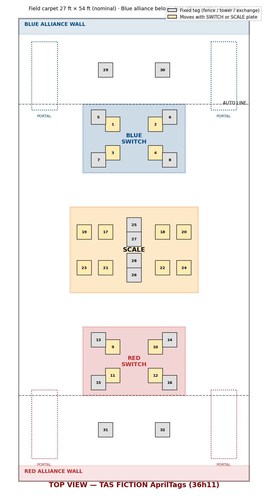

Figure B-1: Top-down field map with fiction AprilTag IDs 1–32. Grey = fixed; tan = moves with plate. **Not official.**

# 11 Glossary {.glossary}

Definitions are TAS paraphrases. The official glossaries are 2018 Section 11 and the 2026 manual's glossary.

**Table C-1: Game terms (2018)**

| Term | Meaning in this manual |
| --- | --- |
| ALLIANCE | A cooperative of three robots/teams (Red or Blue) in a MATCH. |
| ALLIANCE STATION | The 22 ft × 10 ft area behind the ALLIANCE WALL where the drive team stands. |
| ALLIANCE WALL | Three PLAYER STATIONS plus the EXCHANGE; separates robots from people. |
| ARCADE | Everything needed to play: field, elements, cubes, electronics. |
| AUTO | The first 15 seconds; robots run pre-programmed code only. |
| AUTO LINE / AUTO-RUN | Tape 10 ft from the ALLIANCE WALL; crossing it with a bumper in AUTO scores 5. |
| AUTO QUEST | Ranking point for three AUTO-RUNS plus SWITCH OWNERSHIP at the end of AUTO. |
| BOOST | POWER UP that doubles OWNERSHIP points for 10 s. |
| BRICKS | Graphics at the base of the SCALE to 12 in. above the PLATFORM; CLIMBED robots' bumpers must be above them. |
| CLIMB / CLIMBED | Fully supported by the SCALE, bumpers above the BRICKS, not touching the PLATFORM at T=0; 30 points. |
| ENDGAME | The last 30 seconds of TELEOP. |
| EXCHANGE | Alliance-wall opening (16.25 in. tall) where robots pass cubes to HUMAN PLAYERS; includes the RETURN. |
| EXCHANGE ZONE | 4 ft × 3 ft area in front of the EXCHANGE. |
| FACE THE BOSS | Ranking point for three CLIMBS (or two plus LEVITATE). |
| FENCE | 18.75 in. tall barrier around each SWITCH. |
| FORCE | POWER UP that awards OWNERSHIP points regardless of PLATE position for 10 s. |
| FRAME PERIMETER | Taut-string outline of the robot frame at bumper height, bumpers excluded (2018 R01). |
| LEVITATE | POWER UP (3 cubes) that credits one extra CLIMB. |
| MATCH | One 2:30 game between two alliances. |
| NULL TERRITORY | Areas at each end of the SCALE; the matching alliance's robots there are protected (G16). |
| OWNERSHIP | State in which a SWITCH or the SCALE is tilted toward an alliance's PLATE (or forced by FORCE); scores per second. |
| PARKING | Fully supported by the SCALE (e.g. on the PLATFORM) at the end without CLIMBING; 5 points. |
| PIN | Preventing an opponent from moving; limited to 5 s (G14). |
| PLATE | One of the two tilting trays on each SWITCH and on the SCALE. |
| PLATFORM / PLATFORM ZONE | Raised alliance-coloured base of the SCALE (3½ in.) / the taped zone around it. |
| PORTAL | Corner station where HUMAN PLAYERS feed cubes through a 14 in. opening 20 in. up. |
| POWER CUBE | 13 × 13 × 11 in. yellow-covered crate, about 3¼ lb. |
| POWER CUBE ZONE | Area by each SWITCH holding the alliance's 10-cube pile. |
| POWER UP | FORCE, BOOST or LEVITATE, bought with cubes in the VAULT. |
| RETURN | Opening above the EXCHANGE through which humans send cubes back to the field. |
| RUNG | 13 in. pipe on the SCALE, top 84 in. above the carpet, for climbing. |
| SCALE | Central tilting element with two PLATES; shared by both alliances. |
| STARTING CONFIGURATION | The robot's physical configuration at the start of a MATCH. |
| SWITCH | Tilting element near each alliance; only its own alliance can own it. |
| TECHNICIAN | Drive-team member (new in 2018) responsible for robot setup and connectivity. |
| TELEOP | The 2:15 driver-controlled period. |
| VAULT | Three-column structure where HUMAN PLAYERS place cubes for POWER UPS and points. |

**Table C-2: Construction and control terms (2026)**

| Term | Meaning in this manual |
| --- | --- |
| BUMPER | Required padded assembly around the ROBOT PERIMETER (R401–R412). |
| BUMPER ZONE | 2.5–5.75 in. above the floor; bumper padding must fill it (R405). |
| CAN / CANivore | Controller Area Network bus for motor controllers and hubs / CTRE USB-to-CAN adapter (R717). |
| COTS | Commercial off-the-shelf. |
| Driver Station | The official software that sets robot mode and enable state (R901). |
| FMS | Field Management System. |
| OPERATOR CONSOLE | Everything drivers use to command the robot, including the Driver Station device (R901–R907). |
| PD | The robot's main power distribution device (PDP, PDP 2.0, PDH, AMPD). |
| Propulsion motor | A motor that moves the robot across the carpet (R502 limit: 4). |
| roboRIO | The 2026 robot controller (R701). |
| ROBOT PERIMETER | 2026 name for the taut-string frame outline (R101). |
| RSL | Robot Signal Light (R709). |
| Systemcore | The robot control system named in the 2027 preview. |
| Wireless bridge | The robot radio (Vivid Hosting VH-109 in 2026, R702). |

<blockquote class="mock-notice"><strong>TAS MOCK · HYPOTHETICAL · NOT OFFICIAL.</strong> TAS-MOCK-V1 · 2026-11-09. Official sources: <a href="https://firstfrc.blob.core.windows.net/frc2018/Manual/2018FRCGameSeasonManual.pdf">2018 Game Manual</a> · <a href="https://firstfrc.blob.core.windows.net/frc2026/Manual/2026GameManual.pdf">2026 Game Manual</a> · Game animation: <a href="https://www.youtube.com/watch?v=HZbdwYiCY74">YouTube HZbdwYiCY74</a>.</blockquote>
